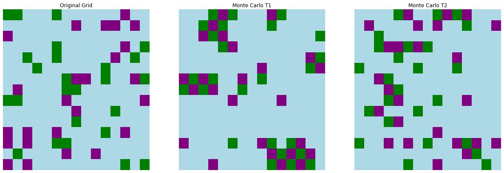
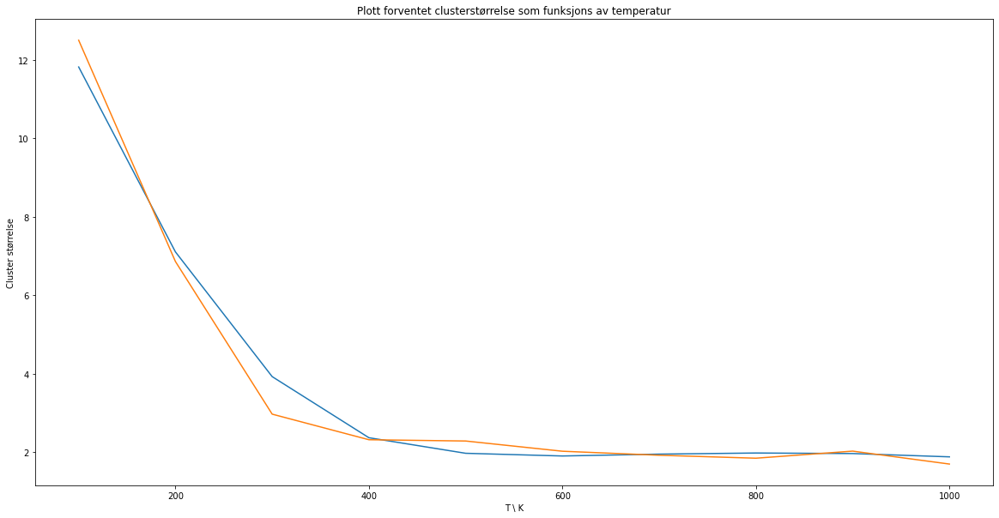

# Monte Carlo simulation of monomers and polymers

Biophysics project from TMA4320 at NTNU (spring 2022). We simulate charged monomers and polymers
on a 2D grid with periodic boundaries and look at how temperature and polymer length affect the
clusters they form. The notebook is in Norwegian.

The moves are standard Metropolis: pick a random molecule and direction, accept the move if the
energy goes down, otherwise accept it with probability exp(-ΔE / k_B T). Only nearest neighbours
interact. Polymers can move rigidly (the whole thing shifts) or with a "medium flex" move where
each row or column segment that is free to move shifts on its own.

At low temperature the monomers clump together into bigger clusters. The expected cluster size
drops from about 12 at 100 K to about 2 at 400 K and stays there:

## Running it

Needs numpy, scipy, matplotlib and numba. The cells weren't run strictly top to bottom (1h was
rerun after task 2), and the results are random, so a fresh run won't match the saved output
exactly. The polymer simulations in 2h aren't JIT compiled and took about 23 minutes.
